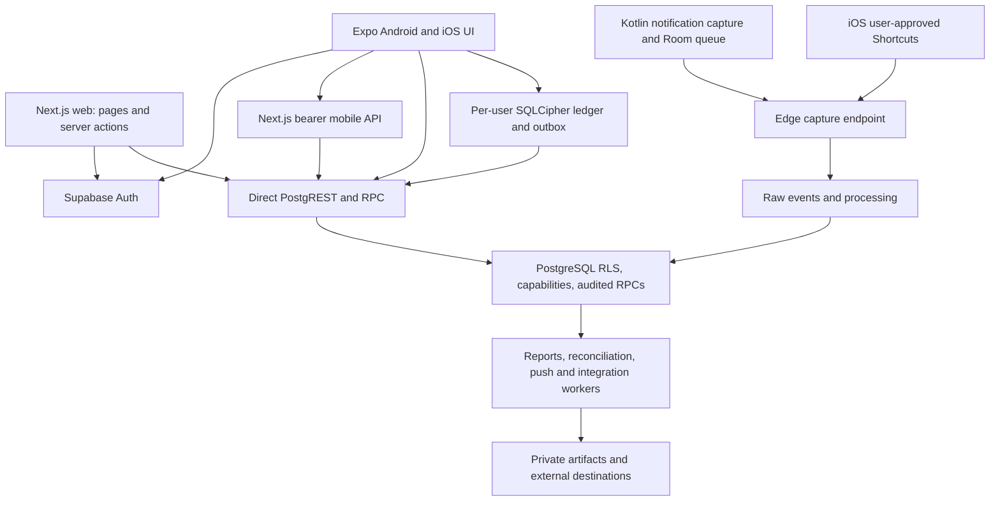

# OneLedger current-state audit

Assessment date: **2026-11-18, Africa/Kigali**. Repository: `cybersafehills/personal-finance-engine`. Assessed checkout: **main, `36ad79b`**. Assessment and planning only; no application changes, hosted-data operations, migration deployment, or PR merges.

Companion outputs: [parity matrix](ONELEDGER_WEB_MOBILE_PARITY_MATRIX.md), [UI/UX assessment](ONELEDGER_UI_UX_ASSESSMENT.md), [implementation roadmap](ONELEDGER_IMPLEMENTATION_ROADMAP.md).

## 1. Executive assessment and evidence limits

OneLedger has a substantial working implementation, not three independent applications awaiting construction. Next.js provides the web product and mobile aggregation APIs. One Expo/React Native application supplies the Android and iOS product UI. Android notification capture lives inside a local Kotlin Expo module. The root `android/` project is the older capture-only companion, superseded architecturally by ADR 0019; it is not an alternative implementation of the full financial product.

The strongest immediate concerns are household source privacy, active-Space selection, currency correctness, divergent transfer exclusions, and retained offline data after access withdrawal. These take precedence over visual density changes. Several fixes are already in PRs: reuse and review those changes before creating replacements.

Evidence labels used throughout these documents:

- **Source-confirmed:** the cited code demonstrates the behavior or missing guard. This does not establish production exposure.
- **Locally tested:** the command was run in this assessment; its actual result appears below.
- **Candidate:** a plausible defect requiring a targeted reproduction or environment check.
- **Unknown:** hosted deployment, live configuration, physical-device behavior, or provider behavior was not verified.

No authenticated browser journey, emulator, physical iPhone/Android journey, EAS build, production database inspection, production feature-flag inspection, or hosted scheduler check was performed. Existing screenshots and historical audit claims are not current runtime verification. Statuses in the matrix describe implementation coverage, never a production sign-off.

## 2. Repository discovery and work in progress

`git status --short` initially contained only untracked `.DS_Store` and `oneledger-mobile/.claude/`. Both were preserved and not read as product evidence. There were no tracked implementation modifications. Read `web/AGENTS.md` and `oneledger-mobile/AGENTS.md`: framework-version guidance applies before implementation; mobile lint and typecheck were both attempted separately.

Local `origin/main` matched HEAD at assessment start. Remote-tracking branches were inspected with `git branch -avv`; they are cached refs, not proof of remote freshness. No fetch, checkout, reset, commit, or rebase was performed. Linked worktrees were left untouched. The `fix/counterparty-visibility` local ref moved during the assessment, reinforcing the need to refresh branch heads before subsequent implementation.

| Already in assessed main | Commit | Implication |
|---|---|---|
| Space-aware Wallets/Home handling, add/default wallets | `36ad79b`, #280 | Do not propose Wallets as wholly absent; legacy query paths still need review. |
| Encrypted offline ledger, outbox, category conflict sync | `6e6fde0`, #272 | `docs/offline-first.md` still says not merged; that sentence is stale. |
| Mobile Bills original-file access | `fd503de`, #279 | Native upload/review remains absent; original download already exists. |
| Silent-phone health warning | `f94f194`, #278 | Existing health work should be reused. |
| Navigation entries and `/plan`, `/goals` aliases | `43dd0c8`, #277 | These aliases are not current 404 gaps. |
| Starter-rule proposals | `babf846`, #276 | Exists, but only considers a capped history. |
| People auto-sort / per-wallet forecast / mobile rule toggles | #275 / #274 / #273 | Existing functionality; assess remaining gaps rather than rebuild. |

Connected GitHub read-only search found the following work. Final direct metadata checks confirmed **#281 merged remotely at 2026-11-18 22:15:33 Africa/Kigali**, merge commit `91baf55`; **#282–#287 remain open**. The local assessed tree remains at `36ad79b`. Consequently F01 describes the local baseline and has a remotely merged remediation, not a new fix to implement. Remote deployment of that remediation remains unknown. Broad search is not a guaranteed exhaustive listing; PR descriptions are authors' claims, not independently rerun PR checks.

| PR | Work and dependencies | Review disposition |
|---|---|---|
| [#281](https://github.com/cybersafehills/personal-finance-engine/pull/281) | Balance-observation source visibility, **merged remotely** at `91baf55` | Verify merged diff/checks/deployment; not present in assessed local tree. |
| [#282](https://github.com/cybersafehills/personal-finance-engine/pull/282) | Counterparty source visibility, originally stacked on #281 | Final metadata shows base `main` at `91baf55`, head `bdfb53e`; review current head, not obsolete stack description. |
| [#283](https://github.com/cybersafehills/personal-finance-engine/pull/283) | Own-account counterparty kind and aggregate exclusions | Shares `getLinkedTransferIds` with #285; mobile kind compatibility needs explicit work. |
| [#284](https://github.com/cybersafehills/personal-finance-engine/pull/284) | Starter rules beyond latest 500 | Reuse; verify transfer exclusion after #283. |
| [#285](https://github.com/cybersafehills/personal-finance-engine/pull/285) | Scope legacy lists and totals to selected Space | Web fix does not establish native direct-query/local-SQL parity. |
| [#286](https://github.com/cybersafehills/personal-finance-engine/pull/286) | Mobile density and native Pay sheet | Not current main; assess larger text and devices before accepting its scale cap. |
| [#287](https://github.com/cybersafehills/personal-finance-engine/pull/287) | Dark transfer fee calculator | Not current main; no native screen, verified MoMo tariff, or split-comparison requirement established. |

Local worktree branches correspond to these topics: `fix/balance-observations-visibility`, `fix/counterparty-visibility`, `feat/own-account-counterparties`, `fix/starter-rules-full-history`, `fix/space-scoped-reads`, `feat/mobile-ui-foundation`, `feat/fee-calculator`. Branch presence alone does not show merge status, especially with squash merges. Final GitHub metadata reports #282 mergeable and #283–#287 not mergeable at that instant; this is not a CI result and must be refreshed before work. #283's described `20270104000000` migration identifier overlaps #281: inspect actual filenames and renumber forward if still colliding before merging.

Deployment remains **unknown**. `.github/workflows/deploy-supabase.yml` intends to deploy the exact green main CI revision, then push migrations and Edge Functions. That configuration is not evidence a run succeeded. Mobile cloud builds are manually triggered (`mobile-build.yml`). `eas.json` sets the production API URL, while local build-time settings may differ. No secrets or private environment values are reproduced here. Migration names extend into January 2027 despite this November assessment date; treat them as migration identifiers, not deployment timestamps.

## 3. Architecture, data and authorization

| Surface | Concrete implementation | Boundaries and limitations |
|---|---|---|
| Web | `web/app`, `web/components`, `web/lib`; Next `16.3.1`, React `19.2.8`, Tailwind 4 | Server components/actions, cookie session and proxy; service-role helpers reserved for trusted operations. |
| Full native product | `oneledger-mobile/src/app`, `src/features`; Expo `~58.0.26`, RN `0.88.1`, React `19.3.0` | Shared source is not proof of independent platform execution. Native projects generated by Expo, not hand-maintained Swift screens. |
| Android capture | `oneledger-mobile/modules/oneledger-capture/android` | NotificationListenerService, provider matching, Room, WorkManager, encrypted credential preferences. JS bridge exposes health/actions, not raw message payloads. |
| Legacy Android | `android/app/src/main/java/me/oneledger/companion` | Compose pairing, QR, queue/health and upload; no budgets, financial Home, goals, reports UI. Same release package merits signing/update testing. |
| Backend | `supabase/functions/{capture,process-raw-events,ingest-momo,inbound-email,reconcile-balances,send-notifications,send-push-notifications}` | Capture acknowledgment is not ledger processing or payment settlement. Dedupe and accounting are server-owned. |
| External services | Supabase Auth/Storage/Realtime; Resend; Expo push; LLM bill extraction/commentary; integration adapters | Provider setup, credentials, consent, quotas and scheduler activation not verified. Accounting/cloud adapters include explicit unimplemented operations. |

### Data relationships and mutation authority

`supabase/migrations/` is the schema source of truth; neither old prose nor UI routes establish deployed schema. The generated inventory at the end lists every migration file.

| Domain | Entities / relationships | Read/write authority and calculations |
|---|---|---|
| Identity and tenancy | `profiles`, `workspaces`, `workspace_memberships`, invites, member capability grants, audit events | Auth identity → active membership; role tiers coexist with closed capability catalog. Unknown capability names fail closed. Source visibility is narrower than membership. |
| Accounts and capture | `accounts` → financial sources; source/Space links; legacy ingestion connections → canonical connector installations/accounts/sources/device credentials; pairing sessions, raw events, MoMo messages | Session RLS for user reads, device credentials for capture, service role for processing. Canonical rollout flags mean both legacy and canonical paths need compatibility tests. |
| Ledger | `transactions`, ledger entries, reconciliations, duplicate evidence, transfer links, splits, tags, category decisions/history | Settlement and principal/fee effects drive totals; failed/pending/merged records cannot be treated as ordinary settled money. Transfer links identify paired own-account movement. |
| Planning | `budgets`, allocations, category mappings; `financial_goals`, contributions and participants | `budget-math.ts`, `getBudgetActuals`, SQL `goal_progress`; explicit period/currency scope required. |
| Analysis and reports | transaction facts, report runs/artifacts/schedules/preferences; financial/provider statements, packs, jobs, schedules, verification tokens | Derived data and snapshots; report/statement math and provenance must remain separate from provider confirmation. |
| People and balances | counterparties → identifiers, merge/split events; transaction counterparty IDs; `balance_observations` → account; `account_balance_baselines_v` | Audited correction RPCs; security-invoker summaries/baselines use underlying RLS. Two newly added base-table policy gaps described below. |
| Payments and directories | intents, handoffs, reconciliations, trusted recipients/templates; requests/events; networks/routes/fees/evidence/permissions; service codes/favorites | Non-custodial handoff only; manual paid acknowledgment distinct from verified transaction matching. Public request tokens generated server-side and hashed. |
| Bills and integrations | bill documents/fields/validation/suppliers/matches/events; integration connections/imports/exports/sync/conflicts/workbooks/destinations; API keys/webhooks | Document extraction is a claim, not a transaction. Posting/approval and external delivery have separate capability and audit boundaries. |
| Device/offline | push devices; `client_operations`; per-user local transactions/accounts/outbox/cursors | Atomic local save + queue; server op-id replay; category compare-and-set; provider status remains server-owned. |

Ordinary web reads use `web/lib/supabase-session-server.ts`. Mobile bearer context substitutes a caller-authenticated client; `mobile-request.ts` validates token with Auth, checks MFA, applies rate limits and `no-store`, and echoes resolved Space. Direct native Supabase operations bypass that HTTP wrapper, so every security property needed there must exist in SQL too. A UI flag or hidden route is not a database permission. Supabase's [RLS documentation](https://supabase.com/docs/guides/database/postgres/row-level-security) confirms the underlying role/policy distinction; the findings below come from this repository's actual SQL.

Relevant reviewed ADRs: 0001–0003 payment/ledger boundaries, 0005 tenancy/source visibility, 0013 iOS capture, 0014 financial intelligence, 0019 Expo replacement. Also reviewed the required parity, offline, design-system and mobile API docs, authorization matrix, release/build configuration, and current feature implementations. Older statements that self-service erasure is absent or the offline foundation is unmerged are superseded by current code.

### Feature gates

`web/lib/oneledger3-flags.ts`: exact `*_ENABLED=true` and optional workspace allowlist for Insights Center, Balance Provenance, Counterparties and Payment Requests. Other gates live in `pay/gate.ts`, `spaces/gate.ts`, `bills/gate.ts`, `integrations/gate.ts`, `financial-statements.ts`, `intelligence/insights.ts`, `experience-mode/gate.ts`, `entitlements/gate.ts` and `account-deletion.ts`.

`MOBILE_API_ENABLED` gates HTTP mobile APIs, not direct PostgREST. `mobile-config.ts` returns several product gates but **does not include the four OneLedger 3 gates**; its `insights` is the intelligence gate, not necessarily Insights Center. `features/more/groups.ts` shows Wallets, People and Payment requests without those individual gates. Result: visible native destinations can lead to unavailable responses; direct RPCs must independently authorize access. `EXPO_PUBLIC_OFFLINE_DISABLED` is a build-time opt-out, not a remotely demonstrated kill switch. Account-deletion request and execution gates are separate.

## 4. Prioritized findings

P0 = security/privacy or money-integrity release blocker for the affected scope; P1 = essential correctness/workflow; P2 = parity/usability; P3 = optional expansion. P0 does not claim a live incident.

| ID | Priority / confidence | Evidence and consequence | Proposed resolution and proof |
|---|---|---|---|
| F01 | P0 on assessed baseline, source-confirmed; remediation merged remotely | `20261224000000_balance_observations.sql`: SELECT requires membership only; definer `record_manual_balance_observation` checks member role but not source visibility. Household co-members can read private-source observations and potentially write by known account ID. | Verify merged #281 (`91baf55`) and deployment rather than duplicate it. Owner/member/viewer tests with private/shared sources, including direct table access, paused shares and hidden-account writes. Author's claim that flags prevent production exposure is unverified and cannot replace SQL authorization. |
| F02 | P0, source-confirmed | `20261225000000_counterparties.sql` and `20261228000000_counterparty_split.sql`: membership-only reads and privileged corrections lack the equivalent private-source guard. Names, normalized phone identifiers and correction history can disclose hidden-source relationships. | Reuse #282 after #281. Test private-only, shared-only, mixed and merged people; guessed-ID mutation denials and undo behavior. |
| F03 | P1, source-confirmed | `web/lib/queries.ts` deliberately omits active workspace filters in legacy transaction/balance/totals/accounts/budget/goal reads. RLS admits all accessible Spaces, not the selected one. Native `features/transactions/queries.ts`, `features/goals/queries.ts`, requests list and local SQL have the same selection gap. | Review #285 for web, then scoped native repository methods and SQL predicates. Two memberships with disjoint records: switch repeatedly, verify lists, totals, balance and writes; by-ID policy documented separately. This is selection correctness, not proof of cross-tenant RLS bypass. |
| F04 | P0, source-confirmed protocol gap | `sync_transactions_changes` returns currently RLS-visible rows; `applyServerPage` only removes merged duplicates. No tombstone/visibility revocation protocol removes a cached row after membership removal, source unshare, move to inaccessible Space or hard deletion. | Define retained-copy policy and bounded authorization freshness; implement online reconciliation/eviction before shared offline rollout. Test download → revoke/unshare → reconnect → verify row, detail and totals inaccessible. Preserve unsynced personal work. Offline revocation latency must be explicit. |
| F05 | P1, source-confirmed | Native `getTodayTotals` sums effects without reading `transfer_links`; web excludes confirmed links. Local schema/feed carries no linked-transfer set. Unpaired own-account payments still affect income/spend on main; #283 proposes a new self kind. | Shared fixture vectors and canonical exclusion semantics across Home, budgets, reports, Insights, forecast and offline. Decide fee treatment explicitly. A linked two-leg transfer must not inflate income/spend; balances must still move. |
| F06 | P0 for non-RWF use, source-confirmed | `TransactionItem.tsx` passes `signedAmountRwf` to RWF-only `MoneyAmount` regardless of `transaction.currency`. Manual account selection allows EUR/USD, whose minor units are stored in legacy `*_rwf` fields by manual RPCs. Today/lifetime totals also sum without currency grouping. | Currency-tagged amounts and aggregation; no invented FX. Fixture USD 12.34 (1234 minor), EUR and RWF simultaneously: correct units/scales everywhere, no combined RWF figure. Review analogous web legacy displays too. |
| F07 | P1, source-confirmed cap mismatch | `supabase/config.toml` has `max_rows=1000`. Web lifetime/today/link reads are not paged. `fetchInsightFacts` asks for 20,001 but does not page: local API cap can return 1,000 and leave `truncated=false`. Several larger explicit limits have the same risk. | Page deterministically or aggregate server-side; detect all caps and present partial status. Verify at 999/1000/1001 and >20,000, using actual PostgREST, not only pure arrays. Hosted cap is unknown. |
| F08 | P1, source-confirmed | Native Home loads local balance/totals/list together with network-only `getReviewQueueCount()` in one `Promise.all`. Offline review-count failure rejects the whole Home load, despite an available ledger. | Separate optional network widgets; test cold offline launch after bootstrap, cached Home/ledger available with freshness and pending labels. |
| F09 | Historical candidate **not reproduced; do not treat as confirmed defect** | Old parity notes claim no-argument `getUser()` fails for a stateless client with Authorization header. Inspection of installed `SupabaseClient.ts` and `GoTrueClient.ts` shows `hasCustomAuthorizationHeader` supports that case. A no-network mocked-fetch probe resolved the fixture user and forwarded the bearer header with no stored session. | Retain real bearer-only endpoint integration tests, especially against lockfile-installed releases, but do not refactor identity handling based solely on that historical claim. This probe proves installed SDK behavior, not all deployed endpoint logic. |
| F10 | P1, source-confirmed guard disparity | Web request mark-paid/link actions require MFA; native `features/requests/actions.ts` calls RPCs directly. Request SQL helper checks membership/role, with no AAL check in this migration. App navigation MFA is not an API boundary. | Define required assurance per operation; enforce in SQL or constrained server-only mutation path. Test AAL1 with enrolled MFA, AAL2, viewer, removed member and unrelated workspace. Also test that definer link RPC cannot use a hidden-source transaction guessed by ID. No exploit was run. |
| F11 | P1, locally observed environment issue | Typechecks fail on stale generated route types and missing installed `geist`/`pdfjs-dist` despite package declarations. Mobile route `/categorization-rules` exists but generated route union rejects it. | Clean reproducible dependency install and route generation in an isolated checkout; rerun builds. Classify stale environment versus true source defect before changing implementation. |
| F12 | P2, source-confirmed | Native Home remains single newest transaction balance; web has per-wallet carousel/provenance. `PrivacyProvider` is in-memory; Wallets renders amount/accessibility text directly, bypassing it. New feature gates omitted from config/menu as above. | Reuse wallet read model, persist privacy and define full-mode scope; gate destinations consistently; test hidden values in accessibility output and across relaunch. |
| F13 | P1, source-confirmed failure mode | `getLinkedTransferIds` logs failure and returns empty set; other legacy queries turn errors into zeros/empty lists. This can present incorrect totals or false empty states. New wallet loader correctly throws on partial read. | Propagate unavailable/partial state, use last known explicitly dated data where appropriate. Fault-injection tests must not show a false financial zero or inflate totals. |
| F14 | P2, source-confirmed | `useQuery` retains old `data` while reloading on Space switch; many screens hide `error` if data exists. Incorrect old-Space content can remain under new context on failed load. | Key visible data by user/Space/query; clear or segregate at switch, show refresh failure with last-success time. Test slow/reversed responses and offline Space switch. |
| F15 | P2, source-confirmed | `starter/page.tsx` reads latest 500 rows; history count/proposals are bounded. Cloud/accounting/workbook registry methods explicitly throw `provider_*_not_implemented` or use stubs. | Reuse #284; describe integration adapters honestly and finish only product-approved provider slices. Never mark OAuth setup or catalog presence as successful sync. |
| F16 | P1, candidate | Sync single-flight is module-global, not per database/user; provider closes DB on account change without explicit sync cancellation. Two-minute cursor overlap cannot guarantee capture of arbitrarily late commits; 500-page guard marks pull complete even without exhaustion. | Test rapid account switch during push/pull, old-user outbox cannot upload as new user, long transactions and pull cap. Add scoped lifecycle/cancellation and monotonic feed/reconciliation as needed. Current small-fixture tests do not prove these cases. |

### Financial and security strengths to preserve

- SQL accounting effects and generated net effect, explicit settlement, duplicate preservation and tenant-scoped ingest dedupe; parser/accounting fixtures and migration constraints exist.
- `loadWallets` shares `deriveBalance` with mobile, showing confirmed/estimated/stale/unavailable rather than presenting all numbers as current provider balance.
- Budget actuals, report arithmetic and Insights have dedicated pure functions/tests. Mixed currencies are kept separate in the newer Insights model. Do not replace these with screen-local arithmetic.
- Offline create stores financial row and outbox atomically. Stable client UUID and op-id, server advisory lock, replay outcome and operation ownership prevent ordinary retry duplication. Category edits compare base/desired/server fields, preserve conflicts and let the user choose a resolution.
- SQLCipher presence is checked before storing financial data; no plaintext fallback. Keys live in SecureStore, databases are per user; native Android credential storage uses encrypted preferences. Biometric UI lock and app-switcher cover exist, while background capture stays functional.
- Pay state machine does not infer payment from handoff, manual confirmation differs from verified reconciliation, and public request views are distinct from owner controls. QR trust/classification has dedicated tests. Preserve ADR 0001.
- Utility tokens have encrypted storage, audited reveal and scrubbing migrations; mobile reveal uses the server endpoint rather than caching provider tokens as ordinary display fields.

### Offline limitations that remain product decisions

Only ledger reads, manual income/expense saves and category edits form the offline slice. Budgets, goals, wallet management, people, report scheduling and server Insights/Inbox are not offline-capable. Android capture already has its own queue; it should not create a second local financial transaction before the server parser does. iOS has no analogous native notification listener; Shortcuts forwarding is a separate user-approved path.

Key loss or reinstall can lose unsynced entries; sign-out keeps the previous user's DB/key for their next sign-in. `destroyUserDatabase` exists, but its presence alone does not prove account-erasure lifecycle wiring. `expo-db.ts` deletes/recreates the database after broad open errors: distinguish actual key failure from transient/full-storage errors before discarding pending work. Default app-lock detection turns the preference off when enrollment is unavailable; review and test that recovery policy with the product owner.

## 5. Verification actually performed

All commands started from repository root, using subdirectory working directories where package scripts require them. No dependency installation or application build was performed.

| Check | Actual result | What it does / does not prove |
|---|---|---|
| `deno test --config web/lib/deno.json web/lib` | **1062 passed, 0 failed** | Pure web logic baseline, not HTTP/DB/browser integration. |
| `deno test supabase/functions` | **311 passed, 0 failed** | Parser/accounting/capture and worker test baseline; not deployed functions. |
| Mobile `npm test -- --ci --runInBand` | **97 suites, 972 tests passed** | JS/screens/SQLite test baseline; not SQLCipher native linkage, background capture or device UX. |
| Mobile `npm run lint` | **Passed** | Current installed lint toolchain. |
| Mobile `npm run typecheck` | **Failed** | `/categorization-rules` rejected by generated route type at `src/app/(app)/categories.tsx:23`. Needs regenerated route verification. |
| Web `npm run lint` | **0 errors, 4 warnings** | Two unused disables in `LiveDataSync.tsx`; two unused parameters in `category_totals_test.ts`. |
| Web `./node_modules/.bin/tsc --noEmit` | **Failed** | Generated AppRoutes missing Insights/People/requests/public-request paths; missing `geist/font/sans` and `pdfjs-dist`; derivative params errors. Does not establish clean-install build failure. |
| `supabase/migrations/tests/run_migration_tests.sh` | **953 passed, 0 failed**, disposable PG17 | First sandboxed attempt could not create shared memory. Authorized retry outside sandbox passed; includes accounting, ACL/RLS and two-tenant sweep. Does not cover all F01–F16 scenarios. |
| Header-auth SDK probe (mock fetch, no network) | **Passed** | No-argument `getUser()` resolved a fixture user and forwarded supplied Authorization with no session. Historical F09 explanation not reproduced in installed SDK. |
| Web Playwright / axe / visual / clean production build | **Not run** | Existing specs and screenshot inspected as artifacts only; local dependencies/types currently not ready. |
| Kotlin Gradle / native binary / EAS / physical devices | **Not run** | CI workflow definitions reviewed; no current CI pass or device release claimed. |

Session logs were written to `/private/tmp/oneledger-audit-{web-tests,edge-tests,mobile-tests,migrations}.log` as transient diagnostics. Counts above are captured here so the report does not depend on those temporary files.

## 6. Release questions and dependencies

1. Which web deployment SHA, database migration versions, Edge Function revisions and EAS binaries are actually serving users? Capture read-only deployment evidence separately; do not infer from main.
2. Which household/source-sharing/OneLedger 3 feature gates and allowlists are enabled? Raw SQL findings matter regardless of app navigation flags.
3. What is the permitted retention duration for a shared record after access removal, including a device remaining offline? Define an authorization lease/eviction policy before broad offline use.
4. Are non-RWF accounts in use? Restrict affected displays until F06 is proven resolved; no implied FX conversion.
5. Does paid iOS enrollment, APNs/FCM configuration and Shortcut publication exist now? Release docs describe earlier blockers; they were not verified against current accounts.
6. Are report/statement/bill/reconciliation/push schedulers actually active, with retry/alert ownership? Function and route existence do not answer this.
7. Which external accounting/cloud/workbook provider is a committed requirement? Current adapter contracts exceed completed end-to-end implementation.
8. Confirm source visibility and AAL requirements for every definer RPC, including request matching and newer manual/offline writes, with adversarial role tests. Update the authorization matrix from actual migration state.

The roadmap orders these dependencies before expanding native screens. Its acceptance fixtures must cross web, Android and iOS and exercise real PostgREST limits, revoked membership and provider handoff boundaries.

## 7. Feature read/write and interaction-state register

This register supplies the persistence/mutation/state details for the parity rows. Route and API enumeration follows in §8. **L/E/R/S** = loading, empty, retryable error and success. These are source paths/patterns to exercise, not a claim that every state was rendered. Ordinary reads/writes use the caller's session unless explicitly described as worker/service-role. Tests are mapped per feature in the parity matrix.

| Feature family | Reads / entities | Writes / server contract | Gate / expected states / remaining limit |
|---|---|---|---|
| Auth/onboarding | Auth user, profile preferences, milestones | `app/{login,signup,onboarding}/actions.ts`, Auth callback/confirm/reset; mobile auth sign-in endpoint | Assurance and verified email; pending/invalid/expired link, locked account, MFA challenge, completed setup; email/redirect configuration unknown. |
| Home/ledger/search | `transactions`, accounts, linked transfers; `getRecentTransactions/getTodayTotals/getLifetimeFlowTotals` | Read-only summaries; add/detail link to owning actions | Signed-in membership; skeleton/first-use/no matches/error/data; false-zero, Space, transfer and currency defects above. |
| Manual transaction | Active accounts, account currency | `create_manual_transaction`; offline `sync_create_manual_transaction` writes transaction/accounting plus op outcome | Current manual RPC requires account workspace owner; validation, saving, saved-on-phone, rejected/synced; online replay policy differs. |
| Categorization/review | Transactions, policies, decision history, suggested category | `apply_manual_category_correction`, review actions; offline `sync_set_category` | Categorize capability/member checks; no suggestion/conflict/confirm/dismiss/retry; remember-rule not queued offline. |
| Rules/starter proposals | Categorization policies and transaction evidence | Rules actions create/update/order/preview/apply; mobile active toggle reads back write | Rule permission/source scope; empty rules, proposed-only, preview, approved apply, paused/error; starter history capped on baseline. |
| Duplicates | Duplicate evidence/canonical transaction and Inbox items | Duplicate merge/dismiss RPCs, audit | Domain authorization; possible duplicate, merged, dismissed, forbidden/error; merge must update all financial displays and cache. |
| Tags | Transaction tag assignments/catalog | `lib/transaction-tags.ts`, mobile tag queries/actions | Caller RLS; empty/saving/readback/error; no offline tag operations. |
| Splits and attribution | Transaction, split rows, membership directory | `setTransactionSplits/clearTransactionSplits`, `set_transaction_attribution` | Categorize/member/ownership policy; invalid sum/member, saved/retry; native attribution exists, native split editor missing. |
| Own transfers | Transfer candidates, `transfer_links`, accounts | `app/transactions/transfers/actions.ts` → link/unlink domain | Confirmed pair versus suggestion; no candidate/mismatch/linked/undo/error; unpaired self-kind support pending #283. |
| Wallets/reconciliation | Accounts, source links, observations, baseline view/reconciliation rows | Add wallet via account actions, set default, `record_manual_balance_observation`; reconciliation worker | Balance provenance flag + SQL source policy; no baseline, confirmed, estimated, stale, unavailable, save/error; #281 remotely merged, local baseline gap. |
| Budgets | Budget template/allocations/category mappings; actual settled outflows/income and splits | Create/edit income/allocations/activate/archive/duplicate/rollover actions | Budget capabilities/period rules; draft/active/archived, unmapped/uncategorized, insufficient data, exceeded/error; native authoring incomplete. |
| Goals | Financial goals, contributions/participants; `goal_progress` | Create/contribute/remove/complete/archive and participant RPC/actions | Goal capability, currency; no goals, target reached, archived, pace unavailable/error; native progress display only. |
| Insights/forecast | Scoped transaction facts, transfer links, counterparties, wallet baselines, recurring payments/bill due dates | Read models only; no ledger mutation from advice | Separate Center/intelligence gates; missing history/partial read/no baseline/error; deterministic forecast assumptions, currency-separated output. |
| Inbox/notifications | Aggregated domain problems and notifications | Each inline decision calls its owning RPC; mark-one/all read; preferences | Shared/domain permissions; loading/all caught up/unavailable/grouped/decision pending/error; some native drills open browser. |
| Reports | Report run/settings, artifact snapshots, delivery log | Settings update; generate/deliver/claim/retry workers and short-lived download route | Report config capability/worker secret; generating/ready/failed/no reports, expired link; live scheduling unknown. |
| Statements | Generated/provider statement facts, snapshots, packs, schedules, verification record | Statement actions/jobs, schedule worker, import and signed document routes | Financial statements flag/capability; queued/ready/failed/coverage warnings/reissue/revoked/expired token; native download only. |
| Bills | Document and storage object, extraction/line fields, validation, duplicate/supplier/match/event records | Intake → process/extract → review/correct → approve → link/post; audited original-file POST | Bills/extraction gates and granular capabilities; uploaded/processing/needs review/approved/posted/failed/archived; extraction never implies ledger truth. |
| People | Counterparties/identifiers/effective merges and transaction grouping | Backfill/sort, update, merge/undo, split/undo RPCs | Counterparties flag plus source privacy; no people/search none/merged/separated/undo/error; source policy fix #282 pending. |
| Utility receipts | Transaction/receipt/sensitive-detail association | Parser capture, encrypted store and audited reveal; scrub worker/migrations | Fresh auth and authorized server reveal; no token/reveal pending/hidden/error; no raw token in ordinary display or logs. |
| USSD/networks | Published service/network/routes/limits/fees/evidence, favorites | Favorites/use metadata, suggestions; operator authoring/publish RPCs | Pay/service/directory gates + directory grants; no route/unverified route/unsupported device/copied/dialed; no provider PIN input. |
| Assisted Pay/recipients/templates | Intent context/history, directory, saved recipients/templates | Create intent, record handoff/transition/cancel/manual confirm; reconciliation worker matches evidence | Pay/assisted/scan/trusted-recipient gates; draft→awaiting verification→verified/failed/expired/reconciliation; never success from handoff. |
| Payment requests | Token-free owner view/events, candidate incoming transactions; public hashed-token lookup | Server-generated token create; cancel/manual-paid/link-payment RPCs | Request gate and membership/ownership; open/expired/cancelled/manual paid/matched; direct-RPC assurance/source gap needs tests. |
| Imports/exports/packages | Staged file rows/mappings/conflicts, source transactions, export jobs/artifacts | Analyze→preview→commit; export/build/deliver; reconciliation resolutions | Integration capabilities; mapping required/invalid rows/ready/committed/partial/failed; formulas neutralized; supported formats vary. |
| External sync/developer | Connections, workbook revisions, sync runs/cursors/conflicts, API keys/webhook metadata | OAuth callback, provider adapters, key rotate/revoke, signed webhook dispatch/deliver | Integration/developer flags; unconfigured/not implemented/conflict/retry/complete; actual provider operations remain partial. |
| Profile/privacy/security/plan/deletion | Profile/ui preferences, factors/sessions, stored plan, erasure request | Settings actions, MFA/session controls, export, schedule/cancel deletion, separate erasure worker | Fresh auth, entitlements only on approved automation/collaboration; pending/cancelled/completed erasure; no payment checkout proven from plan page. |
| Pairing/capture/push | Pair sessions, device credentials/health/queue; push devices | Redeem/rotate/revoke credential; native queue→capture→raw-event processor; opt-in push registration/delivery | Expiring pairing, authenticated device, notification permission; setup/stale/paused/revoked/queued/failed; no native iOS listener. |
| Offline local sync | Per-user encrypted transactions/accounts/outbox/cursor | Atomic local create/category edit; op-id replay and pull; conflict choose/retry/discard | SQLCipher/session/build opt-out; local/pending/syncing/conflict/rejected/stalled/synced; no shared revocation feed on assessed baseline. |

## 8. Exhaustive entry-point inventory (generated from assessed files)

The following enumeration prevents route-existence claims from hiding missing workflows. It inventories files and exports, not end-to-end outcomes. URL groups inherit the domain details above and the parity matrix. Private environment files, dependency trees and generated native projects are excluded.

### Web pages (126)

| Group | Route → source |
|---|---|
| Home | `/` → [page.tsx](../web/app/page.tsx) |
| admin | `/admin/directory/institutions` → [page.tsx](../web/app/admin/directory/institutions/page.tsx) `/admin/directory/institutions/participation/[id]` → [page.tsx](../web/app/admin/directory/institutions/participation/[id]/page.tsx) `/admin/directory/institutions/participation/new` → [page.tsx](../web/app/admin/directory/institutions/participation/new/page.tsx) `/admin/directory/networks/[id]` → [page.tsx](../web/app/admin/directory/networks/[id]/page.tsx) `/admin/directory/networks/new` → [page.tsx](../web/app/admin/directory/networks/new/page.tsx) `/admin/directory/networks` → [page.tsx](../web/app/admin/directory/networks/page.tsx) `/admin/directory` → [page.tsx](../web/app/admin/directory/page.tsx) `/admin/directory/permissions` → [page.tsx](../web/app/admin/directory/permissions/page.tsx) `/admin/directory/routes/[id]` → [page.tsx](../web/app/admin/directory/routes/[id]/page.tsx) `/admin/directory/routes/new` → [page.tsx](../web/app/admin/directory/routes/new/page.tsx) `/admin/directory/routes` → [page.tsx](../web/app/admin/directory/routes/page.tsx) `/admin/directory/sources` → [page.tsx](../web/app/admin/directory/sources/page.tsx) `/admin/directory/suggestions` → [page.tsx](../web/app/admin/directory/suggestions/page.tsx) `/admin/ussd/[id]` → [page.tsx](../web/app/admin/ussd/[id]/page.tsx) `/admin/ussd/new` → [page.tsx](../web/app/admin/ussd/new/page.tsx) `/admin/ussd` → [page.tsx](../web/app/admin/ussd/page.tsx) |
| auth | `/auth/confirm` → [page.tsx](../web/app/auth/confirm/page.tsx) `/auth/mfa` → [page.tsx](../web/app/auth/mfa/page.tsx) `/auth/reset-password/confirm` → [page.tsx](../web/app/auth/reset-password/confirm/page.tsx) `/auth/reset-password` → [page.tsx](../web/app/auth/reset-password/page.tsx) |
| bills | `/bills/[id]` → [page.tsx](../web/app/bills/[id]/page.tsx) `/bills` → [page.tsx](../web/app/bills/page.tsx) |
| budgets | `/budgets/[id]` → [page.tsx](../web/app/budgets/[id]/page.tsx) `/budgets/categories` → [page.tsx](../web/app/budgets/categories/page.tsx) `/budgets/goals/[id]` → [page.tsx](../web/app/budgets/goals/[id]/page.tsx) `/budgets/goals/new` → [page.tsx](../web/app/budgets/goals/new/page.tsx) `/budgets/goals` → [page.tsx](../web/app/budgets/goals/page.tsx) `/budgets/new` → [page.tsx](../web/app/budgets/new/page.tsx) `/budgets` → [page.tsx](../web/app/budgets/page.tsx) |
| categories | `/categories/insights` → [page.tsx](../web/app/categories/insights/page.tsx) `/categories` → [page.tsx](../web/app/categories/page.tsx) `/categories/rules/[id]/apply` → [page.tsx](../web/app/categories/rules/[id]/apply/page.tsx) `/categories/rules/[id]/edit` → [page.tsx](../web/app/categories/rules/[id]/edit/page.tsx) `/categories/rules/history` → [page.tsx](../web/app/categories/rules/history/page.tsx) `/categories/rules/new` → [page.tsx](../web/app/categories/rules/new/page.tsx) `/categories/rules` → [page.tsx](../web/app/categories/rules/page.tsx) `/categories/rules/starter` → [page.tsx](../web/app/categories/rules/starter/page.tsx) `/categories/rules/suggestions` → [page.tsx](../web/app/categories/rules/suggestions/page.tsx) `/categories/rules/templates` → [page.tsx](../web/app/categories/rules/templates/page.tsx) |
| get-started | `/get-started` → [page.tsx](../web/app/get-started/page.tsx) |
| goals | `/goals` → [page.tsx](../web/app/goals/page.tsx) |
| inbox | `/inbox/forecast` → [page.tsx](../web/app/inbox/forecast/page.tsx) `/inbox` → [page.tsx](../web/app/inbox/page.tsx) |
| insights | `/insights` → [page.tsx](../web/app/insights/page.tsx) `/insights/transactions` → [page.tsx](../web/app/insights/transactions/page.tsx) |
| integrations | `/integrations/accountant` → [page.tsx](../web/app/integrations/accountant/page.tsx) `/integrations/activity` → [page.tsx](../web/app/integrations/activity/page.tsx) `/integrations/connect` → [page.tsx](../web/app/integrations/connect/page.tsx) `/integrations/connections` → [page.tsx](../web/app/integrations/connections/page.tsx) `/integrations/connections/pair` → [page.tsx](../web/app/integrations/connections/pair/page.tsx) `/integrations/connections/setup` → [page.tsx](../web/app/integrations/connections/setup/page.tsx) `/integrations/developer` → [page.tsx](../web/app/integrations/developer/page.tsx) `/integrations/exports` → [page.tsx](../web/app/integrations/exports/page.tsx) `/integrations/imports/[id]` → [page.tsx](../web/app/integrations/imports/[id]/page.tsx) `/integrations/imports/analyze` → [page.tsx](../web/app/integrations/imports/analyze/page.tsx) `/integrations/imports/new` → [page.tsx](../web/app/integrations/imports/new/page.tsx) `/integrations/imports` → [page.tsx](../web/app/integrations/imports/page.tsx) `/integrations/imports/templates` → [page.tsx](../web/app/integrations/imports/templates/page.tsx) `/integrations/marketplace` → [page.tsx](../web/app/integrations/marketplace/page.tsx) `/integrations` → [page.tsx](../web/app/integrations/page.tsx) `/integrations/reconciliation` → [page.tsx](../web/app/integrations/reconciliation/page.tsx) `/integrations/sync/conflicts` → [page.tsx](../web/app/integrations/sync/conflicts/page.tsx) `/integrations/sync` → [page.tsx](../web/app/integrations/sync/page.tsx) `/integrations/sync/runs/[id]` → [page.tsx](../web/app/integrations/sync/runs/[id]/page.tsx) |
| invite | `/invite/[token]` → [page.tsx](../web/app/invite/[token]/page.tsx) |
| legal | `/legal/android-privacy` → [page.tsx](../web/app/legal/android-privacy/page.tsx) `/legal/privacy` → [page.tsx](../web/app/legal/privacy/page.tsx) |
| login | `/login` → [page.tsx](../web/app/login/page.tsx) |
| notifications | `/notifications` → [page.tsx](../web/app/notifications/page.tsx) |
| onboarding | `/onboarding/intent` → [page.tsx](../web/app/onboarding/intent/page.tsx) `/onboarding` → [page.tsx](../web/app/onboarding/page.tsx) `/onboarding/preferences` → [page.tsx](../web/app/onboarding/preferences/page.tsx) `/onboarding/profile` → [page.tsx](../web/app/onboarding/profile/page.tsx) `/onboarding/review` → [page.tsx](../web/app/onboarding/review/page.tsx) |
| pair | `/pair` → [page.tsx](../web/app/pair/page.tsx) |
| pay | `/pay/[id]` → [page.tsx](../web/app/pay/[id]/page.tsx) `/pay/activity` → [page.tsx](../web/app/pay/activity/page.tsx) `/pay/networks/[slug]` → [page.tsx](../web/app/pay/networks/[slug]/page.tsx) `/pay/networks/[slug]/routes/[routeId]` → [page.tsx](../web/app/pay/networks/[slug]/routes/[routeId]/page.tsx) `/pay/networks/[slug]/routes` → [page.tsx](../web/app/pay/networks/[slug]/routes/page.tsx) `/pay/new/[type]` → [page.tsx](../web/app/pay/new/[type]/page.tsx) `/pay/recipients` → [page.tsx](../web/app/pay/recipients/page.tsx) `/pay/reconciliation` → [page.tsx](../web/app/pay/reconciliation/page.tsx) `/pay/requests/[id]` → [page.tsx](../web/app/pay/requests/[id]/page.tsx) `/pay/requests/new` → [page.tsx](../web/app/pay/requests/new/page.tsx) `/pay/requests` → [page.tsx](../web/app/pay/requests/page.tsx) `/pay/suggest` → [page.tsx](../web/app/pay/suggest/page.tsx) `/pay/templates` → [page.tsx](../web/app/pay/templates/page.tsx) `/pay/ussd/[slug]` → [page.tsx](../web/app/pay/ussd/[slug]/page.tsx) `/pay/ussd` → [page.tsx](../web/app/pay/ussd/page.tsx) |
| people | `/people/[id]` → [page.tsx](../web/app/people/[id]/page.tsx) `/people` → [page.tsx](../web/app/people/page.tsx) |
| plan | `/plan` → [page.tsx](../web/app/plan/page.tsx) |
| r | `/r/[token]` → [page.tsx](../web/app/r/[token]/page.tsx) |
| reports | `/reports/[id]` → [page.tsx](../web/app/reports/[id]/page.tsx) `/reports` → [page.tsx](../web/app/reports/page.tsx) `/reports/statements/[id]` → [page.tsx](../web/app/reports/statements/[id]/page.tsx) `/reports/statements/new` → [page.tsx](../web/app/reports/statements/new/page.tsx) `/reports/statements` → [page.tsx](../web/app/reports/statements/page.tsx) |
| settings | `/settings/accounts/[id]` → [page.tsx](../web/app/settings/accounts/[id]/page.tsx) `/settings/accounts` → [page.tsx](../web/app/settings/accounts/page.tsx) `/settings/appearance` → [page.tsx](../web/app/settings/appearance/page.tsx) `/settings/billing` → [page.tsx](../web/app/settings/billing/page.tsx) `/settings/connections` → [page.tsx](../web/app/settings/connections/page.tsx) `/settings/connections/setup` → [page.tsx](../web/app/settings/connections/setup/page.tsx) `/settings/notifications` → [page.tsx](../web/app/settings/notifications/page.tsx) `/settings` → [page.tsx](../web/app/settings/page.tsx) `/settings/privacy/data` → [page.tsx](../web/app/settings/privacy/data/page.tsx) `/settings/privacy` → [page.tsx](../web/app/settings/privacy/page.tsx) `/settings/profile` → [page.tsx](../web/app/settings/profile/page.tsx) `/settings/reports` → [page.tsx](../web/app/settings/reports/page.tsx) `/settings/security` → [page.tsx](../web/app/settings/security/page.tsx) `/settings/sources/import` → [page.tsx](../web/app/settings/sources/import/page.tsx) `/settings/sources` → [page.tsx](../web/app/settings/sources/page.tsx) `/settings/workspace` → [page.tsx](../web/app/settings/workspace/page.tsx) |
| signup | `/signup` → [page.tsx](../web/app/signup/page.tsx) |
| transactions | `/transactions/[id]` → [page.tsx](../web/app/transactions/[id]/page.tsx) `/transactions/new` → [page.tsx](../web/app/transactions/new/page.tsx) `/transactions` → [page.tsx](../web/app/transactions/page.tsx) `/transactions/receipts` → [page.tsx](../web/app/transactions/receipts/page.tsx) `/transactions/review` → [page.tsx](../web/app/transactions/review/page.tsx) `/transactions/transfers` → [page.tsx](../web/app/transactions/transfers/page.tsx) |
| verify | `/verify/[token]` → [page.tsx](../web/app/verify/[token]/page.tsx) |
| verify-email | `/verify-email` → [page.tsx](../web/app/verify-email/page.tsx) |
| wallets | `/wallets` → [page.tsx](../web/app/wallets/page.tsx) |

### HTTP handlers (77)

| Route | Declared methods | Source |
|---|---|---|
| `/api/admin/directory/evidence/[id]` | GET | [api/admin/directory/evidence/[id]/route.ts](../web/app/api/admin/directory/evidence/[id]/route.ts) |
| `/api/admin/email-log` | GET | [api/admin/email-log/route.ts](../web/app/api/admin/email-log/route.ts) |
| `/api/admin/operational-health` | GET | [api/admin/operational-health/route.ts](../web/app/api/admin/operational-health/route.ts) |
| `/api/bills/[id]/original` | GET | [api/bills/[id]/original/route.ts](../web/app/api/bills/[id]/original/route.ts) |
| `/api/bills/[id]/preview` | GET | [api/bills/[id]/preview/route.ts](../web/app/api/bills/[id]/preview/route.ts) |
| `/api/cron/bill-monitoring` | POST | [api/cron/bill-monitoring/route.ts](../web/app/api/cron/bill-monitoring/route.ts) |
| `/api/cron/build-accountant-packages` | POST | [api/cron/build-accountant-packages/route.ts](../web/app/api/cron/build-accountant-packages/route.ts) |
| `/api/cron/deliver-reports` | POST | [api/cron/deliver-reports/route.ts](../web/app/api/cron/deliver-reports/route.ts) |
| `/api/cron/deliver-webhooks` | POST | [api/cron/deliver-webhooks/route.ts](../web/app/api/cron/deliver-webhooks/route.ts) |
| `/api/cron/directory-verification-sweep` | POST | [api/cron/directory-verification-sweep/route.ts](../web/app/api/cron/directory-verification-sweep/route.ts) |
| `/api/cron/expire-pairing-sessions` | POST | [api/cron/expire-pairing-sessions/route.ts](../web/app/api/cron/expire-pairing-sessions/route.ts) |
| `/api/cron/expire-payment-intents` | POST | [api/cron/expire-payment-intents/route.ts](../web/app/api/cron/expire-payment-intents/route.ts) |
| `/api/cron/generate-reports` | POST | [api/cron/generate-reports/route.ts](../web/app/api/cron/generate-reports/route.ts) |
| `/api/cron/process-account-deletions` | POST | [api/cron/process-account-deletions/route.ts](../web/app/api/cron/process-account-deletions/route.ts) |
| `/api/cron/process-bill-documents` | POST | [api/cron/process-bill-documents/route.ts](../web/app/api/cron/process-bill-documents/route.ts) |
| `/api/cron/purge-api-logs` | POST | [api/cron/purge-api-logs/route.ts](../web/app/api/cron/purge-api-logs/route.ts) |
| `/api/cron/reconcile-pending-payments` | POST | [api/cron/reconcile-pending-payments/route.ts](../web/app/api/cron/reconcile-pending-payments/route.ts) |
| `/api/cron/run-balance-reconciliation` | POST | [api/cron/run-balance-reconciliation/route.ts](../web/app/api/cron/run-balance-reconciliation/route.ts) |
| `/api/cron/run-export-jobs` | POST | [api/cron/run-export-jobs/route.ts](../web/app/api/cron/run-export-jobs/route.ts) |
| `/api/cron/run-integration-syncs` | POST | [api/cron/run-integration-syncs/route.ts](../web/app/api/cron/run-integration-syncs/route.ts) |
| `/api/cron/run-statement-jobs` | POST | [api/cron/run-statement-jobs/route.ts](../web/app/api/cron/run-statement-jobs/route.ts) |
| `/api/cron/run-statement-schedules` | POST | [api/cron/run-statement-schedules/route.ts](../web/app/api/cron/run-statement-schedules/route.ts) |
| `/api/health/email` | GET | [api/health/email/route.ts](../web/app/api/health/email/route.ts) |
| `/api/integrations/accountant/[id]` | GET | [api/integrations/accountant/[id]/route.ts](../web/app/api/integrations/accountant/[id]/route.ts) |
| `/api/integrations/exports/[id]` | GET | [api/integrations/exports/[id]/route.ts](../web/app/api/integrations/exports/[id]/route.ts) |
| `/api/integrations/imports/[id]/errors` | GET | [api/integrations/imports/[id]/errors/route.ts](../web/app/api/integrations/imports/[id]/errors/route.ts) |
| `/api/integrations/imports/templates/[key]` | GET | [api/integrations/imports/templates/[key]/route.ts](../web/app/api/integrations/imports/templates/[key]/route.ts) |
| `/api/integrations/oauth/[provider]/callback` | GET | [api/integrations/oauth/[provider]/callback/route.ts](../web/app/api/integrations/oauth/[provider]/callback/route.ts) |
| `/api/integrations/oauth/[provider]/start` | GET | [api/integrations/oauth/[provider]/start/route.ts](../web/app/api/integrations/oauth/[provider]/start/route.ts) |
| `/api/integrations/workbooks/[id]` | GET | [api/integrations/workbooks/[id]/route.ts](../web/app/api/integrations/workbooks/[id]/route.ts) |
| `/api/mobile/accounts` | GET, OPTIONS | [api/mobile/accounts/route.ts](../web/app/api/mobile/accounts/route.ts) |
| `/api/mobile/auth/sign-in` | OPTIONS, POST | [api/mobile/auth/sign-in/route.ts](../web/app/api/mobile/auth/sign-in/route.ts) |
| `/api/mobile/bills/[id]/original` | OPTIONS, POST | [api/mobile/bills/[id]/original/route.ts](../web/app/api/mobile/bills/[id]/original/route.ts) |
| `/api/mobile/bills/[id]` | GET, OPTIONS | [api/mobile/bills/[id]/route.ts](../web/app/api/mobile/bills/[id]/route.ts) |
| `/api/mobile/bills` | GET, OPTIONS | [api/mobile/bills/route.ts](../web/app/api/mobile/bills/route.ts) |
| `/api/mobile/budgets` | GET, OPTIONS | [api/mobile/budgets/route.ts](../web/app/api/mobile/budgets/route.ts) |
| `/api/mobile/categories` | GET, OPTIONS | [api/mobile/categories/route.ts](../web/app/api/mobile/categories/route.ts) |
| `/api/mobile/categorization-rules/active` | OPTIONS, POST | [api/mobile/categorization-rules/active/route.ts](../web/app/api/mobile/categorization-rules/active/route.ts) |
| `/api/mobile/categorization-rules` | GET, OPTIONS | [api/mobile/categorization-rules/route.ts](../web/app/api/mobile/categorization-rules/route.ts) |
| `/api/mobile/config` | GET, OPTIONS | [api/mobile/config/route.ts](../web/app/api/mobile/config/route.ts) |
| `/api/mobile/counterparties/[id]` | GET, OPTIONS | [api/mobile/counterparties/[id]/route.ts](../web/app/api/mobile/counterparties/[id]/route.ts) |
| `/api/mobile/counterparties` | GET, OPTIONS | [api/mobile/counterparties/route.ts](../web/app/api/mobile/counterparties/route.ts) |
| `/api/mobile/inbox` | GET, OPTIONS | [api/mobile/inbox/route.ts](../web/app/api/mobile/inbox/route.ts) |
| `/api/mobile/insights/drilldown` | GET, OPTIONS | [api/mobile/insights/drilldown/route.ts](../web/app/api/mobile/insights/drilldown/route.ts) |
| `/api/mobile/insights/overview` | GET, OPTIONS | [api/mobile/insights/overview/route.ts](../web/app/api/mobile/insights/overview/route.ts) |
| `/api/mobile/pay/intents/[id]/handoff` | OPTIONS, POST | [api/mobile/pay/intents/[id]/handoff/route.ts](../web/app/api/mobile/pay/intents/[id]/handoff/route.ts) |
| `/api/mobile/pay/intents/[id]` | GET, OPTIONS | [api/mobile/pay/intents/[id]/route.ts](../web/app/api/mobile/pay/intents/[id]/route.ts) |
| `/api/mobile/pay/intents` | OPTIONS, POST | [api/mobile/pay/intents/route.ts](../web/app/api/mobile/pay/intents/route.ts) |
| `/api/mobile/pay/scan/classify` | OPTIONS, POST | [api/mobile/pay/scan/classify/route.ts](../web/app/api/mobile/pay/scan/classify/route.ts) |
| `/api/mobile/pay/scan/prepare` | OPTIONS, POST | [api/mobile/pay/scan/prepare/route.ts](../web/app/api/mobile/pay/scan/prepare/route.ts) |
| `/api/mobile/payment-requests` | OPTIONS, POST | [api/mobile/payment-requests/route.ts](../web/app/api/mobile/payment-requests/route.ts) |
| `/api/mobile/reports/[id]/document` | GET, OPTIONS | [api/mobile/reports/[id]/document/route.ts](../web/app/api/mobile/reports/[id]/document/route.ts) |
| `/api/mobile/reports/[id]` | GET, OPTIONS | [api/mobile/reports/[id]/route.ts](../web/app/api/mobile/reports/[id]/route.ts) |
| `/api/mobile/reports` | GET, OPTIONS | [api/mobile/reports/route.ts](../web/app/api/mobile/reports/route.ts) |
| `/api/mobile/spaces/invites/revoke` | OPTIONS, POST | [api/mobile/spaces/invites/revoke/route.ts](../web/app/api/mobile/spaces/invites/revoke/route.ts) |
| `/api/mobile/spaces/invites` | OPTIONS, POST | [api/mobile/spaces/invites/route.ts](../web/app/api/mobile/spaces/invites/route.ts) |
| `/api/mobile/spaces/members/remove` | OPTIONS, POST | [api/mobile/spaces/members/remove/route.ts](../web/app/api/mobile/spaces/members/remove/route.ts) |
| `/api/mobile/spaces/members/role` | OPTIONS, POST | [api/mobile/spaces/members/role/route.ts](../web/app/api/mobile/spaces/members/role/route.ts) |
| `/api/mobile/statements/[id]/document` | GET, OPTIONS | [api/mobile/statements/[id]/document/route.ts](../web/app/api/mobile/statements/[id]/document/route.ts) |
| `/api/mobile/statements` | GET, OPTIONS | [api/mobile/statements/route.ts](../web/app/api/mobile/statements/route.ts) |
| `/api/mobile/transactions/[id]/reveal-token` | OPTIONS, POST | [api/mobile/transactions/[id]/reveal-token/route.ts](../web/app/api/mobile/transactions/[id]/reveal-token/route.ts) |
| `/api/reports/[id]/pdf` | GET | [api/reports/[id]/pdf/route.ts](../web/app/api/reports/[id]/pdf/route.ts) |
| `/api/reports/statements/[id]/document` | GET | [api/reports/statements/[id]/document/route.ts](../web/app/api/reports/statements/[id]/document/route.ts) |
| `/api/reports/statements/packs/[id]` | GET | [api/reports/statements/packs/[id]/route.ts](../web/app/api/reports/statements/packs/[id]/route.ts) |
| `/api/reports/statements/provider/[id]` | GET | [api/reports/statements/provider/[id]/route.ts](../web/app/api/reports/statements/provider/[id]/route.ts) |
| `/api/v1/accounts` | GET | [api/v1/accounts/route.ts](../web/app/api/v1/accounts/route.ts) |
| `/api/v1/categories` | GET | [api/v1/categories/route.ts](../web/app/api/v1/categories/route.ts) |
| `/api/v1/events` | GET | [api/v1/events/route.ts](../web/app/api/v1/events/route.ts) |
| `/api/v1/exports/[id]` | GET | [api/v1/exports/[id]/route.ts](../web/app/api/v1/exports/[id]/route.ts) |
| `/api/v1/exports` | GET | [api/v1/exports/route.ts](../web/app/api/v1/exports/route.ts) |
| `/api/v1/ping` | GET | [api/v1/ping/route.ts](../web/app/api/v1/ping/route.ts) |
| `/api/v1/sync-runs` | GET | [api/v1/sync-runs/route.ts](../web/app/api/v1/sync-runs/route.ts) |
| `/api/v1/transactions/[id]` | GET | [api/v1/transactions/[id]/route.ts](../web/app/api/v1/transactions/[id]/route.ts) |
| `/api/v1/transactions` | GET | [api/v1/transactions/route.ts](../web/app/api/v1/transactions/route.ts) |
| `/api/verify/[token]` | GET | [api/verify/[token]/route.ts](../web/app/api/verify/[token]/route.ts) |
| `/auth/callback` | GET | [auth/callback/route.ts](../web/app/auth/callback/route.ts) |
| `/budgets/[id]/export` | GET | [budgets/[id]/export/route.ts](../web/app/budgets/[id]/export/route.ts) |

### Server-action modules (52)

Exports below are a lexical index; a wrapper may expose additional domain methods.

| Source | Exported function/constant names |
|---|---|
| [admin/directory/actions.ts](../web/app/admin/directory/actions.ts) | `upsertPaymentNetwork`, `setPaymentNetworkState`, `upsertNetworkOperator`, `upsertNetworkFee`, `upsertNetworkLimit`, `upsertRegulatoryAuthority`, `upsertServiceOperator`, `upsertDirectorySource`, `upsertParticipation`, `setParticipationState`, `upsertAccessRoute`, `setAccessRouteState`, `attachEvidence`, `detachEvidence`, `resolveSuggestion`, `grantDirectoryPermission`, `revokeDirectoryPermission` |
| [admin/ussd/actions.ts](../web/app/admin/ussd/actions.ts) | `adminUpsertServiceCode`, `adminSetState`, `adminResolveReport` |
| [auth/confirm/actions.ts](../web/app/auth/confirm/actions.ts) | `confirmSignupEmail` |
| [auth/reset-password/actions.ts](../web/app/auth/reset-password/actions.ts) | `requestPasswordReset`, `updatePassword` |
| [bills/actions.ts](../web/app/bills/actions.ts) | `uploadBillDocument`, `transitionBillDocument`, `archiveBillDocument`, `retryBillExtraction`, `resolveBillDuplicate`, `linkBillSupplier`, `searchSuppliersAction`, `createSupplierForBill`, `approveBillAction`, `postBillAction`, `unlinkBillTransactionAction`, `correctBillField`, `revalidateBillDocumentAction`, `addBillCommentAction` |
| [budgets/actions.ts](../web/app/budgets/actions.ts) | `createBudget`, `updateBudgetIncome`, `updateBudgetAllocations`, `activateBudget`, `archiveBudget`, `duplicateBudget`, `fetchVariableIncomeMonths`, `startCurrentMonthBudget` |
| [budgets/categories/actions.ts](../web/app/budgets/categories/actions.ts) | `setCategoryMapping`, `removeCategoryMapping` |
| [budgets/goals/actions.ts](../web/app/budgets/goals/actions.ts) | `createGoal`, `addManualContribution`, `removeContribution`, `completeGoal`, `setGoalParticipants`, `archiveGoal` |
| [categories/actions.ts](../web/app/categories/actions.ts) | `correctCategory`, `addSpaceCategory`, `editSpaceCategory`, `setSpaceCategoryArchived` |
| [categories/rules/[id]/apply/actions.ts](../web/app/categories/rules/[id]/apply/actions.ts) | `previewHistoricalMatches`, `applyHistoricalBatch`, `revertBulkCategorization` |
| [categories/rules/actions.ts](../web/app/categories/rules/actions.ts) | `upsertPolicy`, `setPolicyActive`, `movePolicyPriority` |
| [categories/rules/suggestions/actions.ts](../web/app/categories/rules/suggestions/actions.ts) | `acceptLearnedSuggestion`, `dismissLearnedSuggestion` |
| [get-started/actions.ts](../web/app/get-started/actions.ts) | `dismissOnboardingChecklist` |
| [inbox/actions.ts](../web/app/inbox/actions.ts) | `setInboxBadgePreference` |
| [integrations/accountant/actions.ts](../web/app/integrations/accountant/actions.ts) | `createAccountantPackage` |
| [integrations/connections/actions.ts](../web/app/integrations/connections/actions.ts) | `pairMtnMomoAdapterCanary`, `pairMtnMomoAdapterCanaryByInstallation`, `setMtnMomoAdapterCanaryEnabled`, `createConnection`, `rotateConnection`, `revokeConnection`, `pauseConnection`, `resumeConnection`, `probeConnectionReadiness`, `probeConnectorCredentialReadiness`, `renameConnection`, `pauseConnectorInstallation`, `resumeConnectorInstallation`, `renameConnectorInstallation`, `rotateConnectorCredential`, `revokeConnectorInstallation` |
| [integrations/connections/pair/actions.ts](../web/app/integrations/connections/pair/actions.ts) | `startDevicePairing`, `getDevicePairingStatus` |
| [integrations/developer/actions.ts](../web/app/integrations/developer/actions.ts) | `createApiKey`, `renameApiKey`, `revokeApiKey` |
| [integrations/developer/webhook-actions.ts](../web/app/integrations/developer/webhook-actions.ts) | `createWebhook`, `updateWebhook`, `rotateWebhookSecret`, `deleteWebhook`, `sendWebhookPing` |
| [integrations/exports/actions.ts](../web/app/integrations/exports/actions.ts) | `createExportJob`, `saveExportTemplate`, `createExportSchedule`, `setExportScheduleEnabled`, `deleteExportSchedule` |
| [integrations/imports/actions.ts](../web/app/integrations/imports/actions.ts) | `uploadImportFile`, `analyzeWorkbookUpload`, `createImportBatchesFromWorkbook`, `applyImportMapping`, `saveImportTemplate`, `setImportBatchTarget`, `setImportRecordsStatus`, `commitImportBatch`, `rollbackImportBatch` |
| [integrations/sync/actions.ts](../web/app/integrations/sync/actions.ts) | `createDestination`, `updateDestination`, `deleteDestination`, `rotateWebhookSecret`, `testDestination`, `createCloudStorageDestination`, `connectWorkbook`, `syncWorkbookNow`, `setWorkbookStatus`, `updateWorkbookSheetMap`, `disconnectWorkbook`, `uploadWorkbookFile`, `resolveConflict`, `applyConflict`, `connectLedger`, `updateLedgerAccountMap`, `setLedgerStatus`, `syncLedgerNow`, `disconnectLedger` |
| [invite/[token]/actions.ts](../web/app/invite/[token]/actions.ts) | `acceptInvite` |
| [login/actions.ts](../web/app/login/actions.ts) | `signIn`, `signOut` |
| [notifications/actions.ts](../web/app/notifications/actions.ts) | `markNotificationRead`, `markAllNotificationsRead` |
| [onboarding/actions.ts](../web/app/onboarding/actions.ts) | `saveProfileOnboarding`, `saveFinancialPreferences`, `completeProfileOnboarding`, `setOnboardingIntent`, `markOnboardingMilestone` |
| [pay/actions.ts](../web/app/pay/actions.ts) | `getLauncherSnapshot`, `toggleFavourite`, `recordUsage`, `reportServiceCode` |
| [pay/assisted-actions.ts](../web/app/pay/assisted-actions.ts) | `createDraftIntent`, `updateDraftIntent`, `recordHandoff`, `applyReconciliation`, `rejectReconciliation`, `linkPaymentManually`, `manuallyConfirm`, `markIntentFailed`, `cancelIntent`, `payAgain`, `createTrustedRecipient`, `updateTrustedRecipient`, `deleteTrustedRecipient`, `createTemplate`, `deleteTemplate` |
| [pay/networks/actions.ts](../web/app/pay/networks/actions.ts) | `toggleRouteFavourite`, `recordRouteUsage`, `reportRoute` |
| [pay/requests/actions.ts](../web/app/pay/requests/actions.ts) | `createPaymentRequestAction`, `cancelPaymentRequestAction`, `markPaymentRequestPaidAction`, `linkPaymentRequestTransactionAction` |
| [pay/scan/actions.ts](../web/app/pay/scan/actions.ts) | `classifyScannedCode`, `prepareScanHandoff`, `recordScanHandoff` |
| [pay/suggest/actions.ts](../web/app/pay/suggest/actions.ts) | `submitDirectorySuggestion` |
| [people/actions.ts](../web/app/people/actions.ts) | `sortTransactionsAction`, `renamePersonAction`, `combinePeopleAction`, `undoCombineAction`, `separateTransactionsAction`, `undoSeparateAction`, `searchPeopleAction` |
| [reports/statements/actions.ts](../web/app/reports/statements/actions.ts) | `previewStatementAction`, `createStatementAction`, `regenerateStatementAction`, `deleteStatementAction`, `createStatementPackAction`, `deleteStatementPackAction`, `saveStatementScheduleAction`, `uploadProviderStatementAction`, `deleteProviderStatementAction`, `deleteStatementScheduleAction` |
| [settings/accounts/actions.ts](../web/app/settings/accounts/actions.ts) | `createAccount`, `renameAccount`, `setPrimaryAccount`, `archiveAccount` |
| [settings/notifications/actions.ts](../web/app/settings/notifications/actions.ts) | `setNotificationPreference` |
| [settings/privacy/actions.ts](../web/app/settings/privacy/actions.ts) | `setHideBalance`, `setPrivacyMode` |
| [settings/privacy/data/actions.ts](../web/app/settings/privacy/data/actions.ts) | `exportMyData`, `requestAccountDeletion`, `cancelAccountDeletion` |
| [settings/reports/actions.ts](../web/app/settings/reports/actions.ts) | `saveReportPreferences` |
| [settings/security/actions.ts](../web/app/settings/security/actions.ts) | `signOutOtherSessions` |
| [settings/sources/actions.ts](../web/app/settings/sources/actions.ts) | `setSourceVisibility`, `allocateSourceToSpace`, `setShareLinkStatus` |
| [settings/sources/import/actions.ts](../web/app/settings/sources/import/actions.ts) | `importStatement`, `enableIngestEmail`, `rotateIngestEmail`, `disableIngestEmail` |
| [settings/workspace/actions.ts](../web/app/settings/workspace/actions.ts) | `setActiveWorkspace`, `createOrganization`, `createHousehold`, `createInvite`, `resendInvite`, `revokeInvite`, `changeMemberRole`, `removeMember` |
| [signup/actions.ts](../web/app/signup/actions.ts) | `signUp` |
| [transactions/[id]/actions.ts](../web/app/transactions/[id]/actions.ts) | `setTransactionAttribution`, `addTransactionTagAction`, `removeTransactionTagAction` |
| [transactions/actions.ts](../web/app/transactions/actions.ts) | `createManualTransaction`, `setTransactionSplits`, `clearTransactionSplits` |
| [transactions/receipts/actions.ts](../web/app/transactions/receipts/actions.ts) | `confirmReceiptAction`, `ignoreReceiptAction`, `unlinkReceiptAction` |
| [transactions/review/actions.ts](../web/app/transactions/review/actions.ts) | `mergeDuplicateTransaction`, `dismissPossibleDuplicate`, `confirmTransactionCategory`, `dismissSuggestedCategory`, `bulkConfirmTransactionCategories`, `bulkDismissSuggestedCategories` |
| [transactions/token-actions.ts](../web/app/transactions/token-actions.ts) | `revealUtilityTokenAction` |
| [transactions/transfers/actions.ts](../web/app/transactions/transfers/actions.ts) | `confirmTransferLink`, `dismissTransferSuggestion`, `unlinkTransfer` |
| [verify-email/actions.ts](../web/app/verify-email/actions.ts) | `verifySignupCode`, `resendVerificationEmail` |
| [wallets/actions.ts](../web/app/wallets/actions.ts) | `recordBalanceAction`, `setDefaultWalletAction` |

### Native screens (45; shared iOS/Android source)

- [(app)/(tabs)/inbox.tsx](../oneledger-mobile/src/app/%28app%29/%28tabs%29/inbox.tsx)
- [(app)/(tabs)/index.tsx](../oneledger-mobile/src/app/%28app%29/%28tabs%29/index.tsx)
- [(app)/(tabs)/more.tsx](../oneledger-mobile/src/app/%28app%29/%28tabs%29/more.tsx)
- [(app)/(tabs)/pay.tsx](../oneledger-mobile/src/app/%28app%29/%28tabs%29/pay.tsx)
- [(app)/(tabs)/plan.tsx](../oneledger-mobile/src/app/%28app%29/%28tabs%29/plan.tsx)
- [(app)/(tabs)/transactions.tsx](../oneledger-mobile/src/app/%28app%29/%28tabs%29/transactions.tsx)
- [(app)/add-transaction.tsx](../oneledger-mobile/src/app/%28app%29/add-transaction.tsx)
- [(app)/bill/[id].tsx](../oneledger-mobile/src/app/%28app%29/bill/[id].tsx)
- [(app)/bills.tsx](../oneledger-mobile/src/app/%28app%29/bills.tsx)
- [(app)/budgets.tsx](../oneledger-mobile/src/app/%28app%29/budgets.tsx)
- [(app)/capture.tsx](../oneledger-mobile/src/app/%28app%29/capture.tsx)
- [(app)/categories.tsx](../oneledger-mobile/src/app/%28app%29/categories.tsx)
- [(app)/categorization-rules.tsx](../oneledger-mobile/src/app/%28app%29/categorization-rules.tsx)
- [(app)/category/[id].tsx](../oneledger-mobile/src/app/%28app%29/category/[id].tsx)
- [(app)/connect.tsx](../oneledger-mobile/src/app/%28app%29/connect.tsx)
- [(app)/create-space.tsx](../oneledger-mobile/src/app/%28app%29/create-space.tsx)
- [(app)/goals.tsx](../oneledger-mobile/src/app/%28app%29/goals.tsx)
- [(app)/insights-detail.tsx](../oneledger-mobile/src/app/%28app%29/insights-detail.tsx)
- [(app)/insights.tsx](../oneledger-mobile/src/app/%28app%29/insights.tsx)
- [(app)/notifications.tsx](../oneledger-mobile/src/app/%28app%29/notifications.tsx)
- [(app)/pair.tsx](../oneledger-mobile/src/app/%28app%29/pair.tsx)
- [(app)/pay/[id].tsx](../oneledger-mobile/src/app/%28app%29/pay/[id].tsx)
- [(app)/pay-again.tsx](../oneledger-mobile/src/app/%28app%29/pay-again.tsx)
- [(app)/pay-new.tsx](../oneledger-mobile/src/app/%28app%29/pay-new.tsx)
- [(app)/people.tsx](../oneledger-mobile/src/app/%28app%29/people.tsx)
- [(app)/person/[id].tsx](../oneledger-mobile/src/app/%28app%29/person/[id].tsx)
- [(app)/recipients.tsx](../oneledger-mobile/src/app/%28app%29/recipients.tsx)
- [(app)/report/[id].tsx](../oneledger-mobile/src/app/%28app%29/report/[id].tsx)
- [(app)/reports.tsx](../oneledger-mobile/src/app/%28app%29/reports.tsx)
- [(app)/request/[id].tsx](../oneledger-mobile/src/app/%28app%29/request/[id].tsx)
- [(app)/request-new.tsx](../oneledger-mobile/src/app/%28app%29/request-new.tsx)
- [(app)/requests.tsx](../oneledger-mobile/src/app/%28app%29/requests.tsx)
- [(app)/scan.tsx](../oneledger-mobile/src/app/%28app%29/scan.tsx)
- [(app)/security.tsx](../oneledger-mobile/src/app/%28app%29/security.tsx)
- [(app)/settings.tsx](../oneledger-mobile/src/app/%28app%29/settings.tsx)
- [(app)/shortcuts.tsx](../oneledger-mobile/src/app/%28app%29/shortcuts.tsx)
- [(app)/space-members.tsx](../oneledger-mobile/src/app/%28app%29/space-members.tsx)
- [(app)/statements.tsx](../oneledger-mobile/src/app/%28app%29/statements.tsx)
- [(app)/sync.tsx](../oneledger-mobile/src/app/%28app%29/sync.tsx)
- [(app)/transaction/[id].tsx](../oneledger-mobile/src/app/%28app%29/transaction/[id].tsx)
- [(app)/ussd/[slug].tsx](../oneledger-mobile/src/app/%28app%29/ussd/[slug].tsx)
- [(app)/ussd/index.tsx](../oneledger-mobile/src/app/%28app%29/ussd/index.tsx)
- [(app)/wallets.tsx](../oneledger-mobile/src/app/%28app%29/wallets.tsx)
- [mfa.tsx](../oneledger-mobile/src/app/mfa.tsx)
- [sign-in.tsx](../oneledger-mobile/src/app/sign-in.tsx)

### Edge entry points

- [capture](../supabase/functions/capture/index.ts)
- [inbound-email](../supabase/functions/inbound-email/index.ts)
- [ingest-momo](../supabase/functions/ingest-momo/index.ts)
- [process-raw-events](../supabase/functions/process-raw-events/index.ts)
- [reconcile-balances](../supabase/functions/reconcile-balances/index.ts)
- [send-notifications](../supabase/functions/send-notifications/index.ts)
- [send-push-notifications](../supabase/functions/send-push-notifications/index.ts)

### Ordered migration chain (140 files)

Identifiers are ordered filenames, not evidence of when hosted migrations ran.

- [20260818000000_baseline_existing_schema.sql](../supabase/migrations/20260818000000_baseline_existing_schema.sql)
- [20260818130000_accounting_foundation.sql](../supabase/migrations/20260818130000_accounting_foundation.sql)
- [20260818130100_balance_reconciliations.sql](../supabase/migrations/20260818130100_balance_reconciliations.sql)
- [20260818130200_revoke_anon_authenticated_privileges.sql](../supabase/migrations/20260818130200_revoke_anon_authenticated_privileges.sql)
- [20260819000000_harden_function_and_sequence_default_privileges.sql](../supabase/migrations/20260819000000_harden_function_and_sequence_default_privileges.sql)
- [20260821000000_phase_b_identity_and_tenancy.sql](../supabase/migrations/20260821000000_phase_b_identity_and_tenancy.sql)
- [20260821000100_phase_b_ownership_backfill_and_constraints.sql](../supabase/migrations/20260821000100_phase_b_ownership_backfill_and_constraints.sql)
- [20260823000000_phase_c_accounts_and_ingestion_connections.sql](../supabase/migrations/20260823000000_phase_c_accounts_and_ingestion_connections.sql)
- [20260824000000_phase_d_budgets_and_goals.sql](../supabase/migrations/20260824000000_phase_d_budgets_and_goals.sql)
- [20260825000000_phase_e_manual_transactions_splits_transfers.sql](../supabase/migrations/20260825000000_phase_e_manual_transactions_splits_transfers.sql)
- [20260826000000_auth_login_lockout.sql](../supabase/migrations/20260826000000_auth_login_lockout.sql)
- [20260827000000_organization_workspaces.sql](../supabase/migrations/20260827000000_organization_workspaces.sql)
- [20260828000000_realtime_publication.sql](../supabase/migrations/20260828000000_realtime_publication.sql)
- [20260829000000_phase_f_categorization_policies.sql](../supabase/migrations/20260829000000_phase_f_categorization_policies.sql)
- [20260830000000_phase_g_review_and_backfill.sql](../supabase/migrations/20260830000000_phase_g_review_and_backfill.sql)
- [20260831000000_phase_h_learned_suggestions.sql](../supabase/migrations/20260831000000_phase_h_learned_suggestions.sql)
- [20260901000000_phase_i_decision_status_index.sql](../supabase/migrations/20260901000000_phase_i_decision_status_index.sql)
- [20260902000000_phase_j_reporting_foundation.sql](../supabase/migrations/20260902000000_phase_j_reporting_foundation.sql)
- [20260903000000_phase_k_report_artifacts.sql](../supabase/migrations/20260903000000_phase_k_report_artifacts.sql)
- [20260904000000_phase_l_ui_preferences.sql](../supabase/migrations/20260904000000_phase_l_ui_preferences.sql)
- [20260905000000_phase_l_grant_is_valid_nav_order_execute.sql](../supabase/migrations/20260905000000_phase_l_grant_is_valid_nav_order_execute.sql)
- [20260906000000_phase_m_ussd_directory.sql](../supabase/migrations/20260906000000_phase_m_ussd_directory.sql)
- [20260906000100_phase_m_ussd_seed.sql](../supabase/migrations/20260906000100_phase_m_ussd_seed.sql)
- [20260906091843_backdate_sole_category_mappings.sql](../supabase/migrations/20260906091843_backdate_sole_category_mappings.sql)
- [20260907000000_phase_n_payment_orchestration.sql](../supabase/migrations/20260907000000_phase_n_payment_orchestration.sql)
- [20260908000000_phase_o_sms_reconciliation.sql](../supabase/migrations/20260908000000_phase_o_sms_reconciliation.sql)
- [20260909000000_phase_p_payment_networks.sql](../supabase/migrations/20260909000000_phase_p_payment_networks.sql)
- [20260909000100_phase_p_payment_networks_seed.sql](../supabase/migrations/20260909000100_phase_p_payment_networks_seed.sql)
- [20260909000200_phase_p_route_favourites.sql](../supabase/migrations/20260909000200_phase_p_route_favourites.sql)
- [20260909000300_phase_p_directory_suggestions.sql](../supabase/migrations/20260909000300_phase_p_directory_suggestions.sql)
- [20260909000400_phase_p_ekash_bank_routes.sql](../supabase/migrations/20260909000400_phase_p_ekash_bank_routes.sql)
- [20260910000000_phase_q_spaces_foundation.sql](../supabase/migrations/20260910000000_phase_q_spaces_foundation.sql)
- [20260911000000_phase_q_spaces_backfill_and_constraints.sql](../supabase/migrations/20260911000000_phase_q_spaces_backfill_and_constraints.sql)
- [20260912000000_phase_r_spaces_authz_and_audit.sql](../supabase/migrations/20260912000000_phase_r_spaces_authz_and_audit.sql)
- [20260913000000_scan_payment_source.sql](../supabase/migrations/20260913000000_scan_payment_source.sql)
- [20260913000100_scan_merchant_pay_codes.sql](../supabase/migrations/20260913000100_scan_merchant_pay_codes.sql)
- [20260914000000_phase_s_shared_ledger_rpcs.sql](../supabase/migrations/20260914000000_phase_s_shared_ledger_rpcs.sql)
- [20260915000000_phase_s_member_directory.sql](../supabase/migrations/20260915000000_phase_s_member_directory.sql)
- [20260916000000_phase_s_household_admin_members.sql](../supabase/migrations/20260916000000_phase_s_household_admin_members.sql)
- [20260917000000_phase_t_notification_resolution.sql](../supabase/migrations/20260917000000_phase_t_notification_resolution.sql)
- [20260918000000_phase_t_budget_threshold_state.sql](../supabase/migrations/20260918000000_phase_t_budget_threshold_state.sql)
- [20260919000000_phase_t_shared_goals.sql](../supabase/migrations/20260919000000_phase_t_shared_goals.sql)
- [20260920000000_phase_t_workspace_categories.sql](../supabase/migrations/20260920000000_phase_t_workspace_categories.sql)
- [20260921000000_phase_u_ingestion_primitives.sql](../supabase/migrations/20260921000000_phase_u_ingestion_primitives.sql)
- [20260922000000_phase_u_duplicate_resolution.sql](../supabase/migrations/20260922000000_phase_u_duplicate_resolution.sql)
- [20260923000000_phase_u_connection_lifecycle.sql](../supabase/migrations/20260923000000_phase_u_connection_lifecycle.sql)
- [20260924000000_phase_u_rule_scope.sql](../supabase/migrations/20260924000000_phase_u_rule_scope.sql)
- [20260925000000_phase_u_statement_import.sql](../supabase/migrations/20260925000000_phase_u_statement_import.sql)
- [20261001000000_phase_v_notifications.sql](../supabase/migrations/20261001000000_phase_v_notifications.sql)
- [20261002000000_phase_v_budget_alerts.sql](../supabase/migrations/20261002000000_phase_v_budget_alerts.sql)
- [20261003000000_phase_v_email_outbox.sql](../supabase/migrations/20261003000000_phase_v_email_outbox.sql)
- [20261004000000_phase_v_report_visibility.sql](../supabase/migrations/20261004000000_phase_v_report_visibility.sql)
- [20261005000000_phase_w_removed_member_notice.sql](../supabase/migrations/20261005000000_phase_w_removed_member_notice.sql)
- [20261006000000_onboarding_checklist_dismissed.sql](../supabase/migrations/20261006000000_onboarding_checklist_dismissed.sql)
- [20261007000000_email_send_log.sql](../supabase/migrations/20261007000000_email_send_log.sql)
- [20261008000000_notification_delivery_claims.sql](../supabase/migrations/20261008000000_notification_delivery_claims.sql)
- [20261009000000_tenant_scoped_ingestion_dedup.sql](../supabase/migrations/20261009000000_tenant_scoped_ingestion_dedup.sql)
- [20261010000000_closed_capability_catalog.sql](../supabase/migrations/20261010000000_closed_capability_catalog.sql)
- [20261011000000_connector_model_stage_a.sql](../supabase/migrations/20261011000000_connector_model_stage_a.sql)
- [20261011050000_connector_stage_b_production_preflight_repair.sql](../supabase/migrations/20261011050000_connector_stage_b_production_preflight_repair.sql)
- [20261012000000_connector_model_stage_b_backfill.sql](../supabase/migrations/20261012000000_connector_model_stage_b_backfill.sql)
- [20261013000000_connector_model_stage_c_dual_write.sql](../supabase/migrations/20261013000000_connector_model_stage_c_dual_write.sql)
- [20261014000000_connector_stage_c_shadow_health.sql](../supabase/migrations/20261014000000_connector_stage_c_shadow_health.sql)
- [20261015000000_connector_stage_d_lifecycle.sql](../supabase/migrations/20261015000000_connector_stage_d_lifecycle.sql)
- [20261016000000_connector_stage_d_credential_history.sql](../supabase/migrations/20261016000000_connector_stage_d_credential_history.sql)
- [20261017000000_connector_stage_d_canonical_auth.sql](../supabase/migrations/20261017000000_connector_stage_d_canonical_auth.sql)
- [20261018000000_connector_stage_d_multi_source_routing.sql](../supabase/migrations/20261018000000_connector_stage_d_multi_source_routing.sql)
- [20261019000000_connector_adapter_route_health.sql](../supabase/migrations/20261019000000_connector_adapter_route_health.sql)
- [20261020000000_mtn_adapter_installation_canary.sql](../supabase/migrations/20261020000000_mtn_adapter_installation_canary.sql)
- [20261021000000_connector_stage_d_read_cutover.sql](../supabase/migrations/20261021000000_connector_stage_d_read_cutover.sql)
- [20261022000000_profile_preferences_onboarding.sql](../supabase/migrations/20261022000000_profile_preferences_onboarding.sql)
- [20261023000000_connector_stage_d_shared_visibility.sql](../supabase/migrations/20261023000000_connector_stage_d_shared_visibility.sql)
- [20261024000000_connector_installation_ingestion_rollout.sql](../supabase/migrations/20261024000000_connector_installation_ingestion_rollout.sql)
- [20261025000000_operational_health_snapshot.sql](../supabase/migrations/20261025000000_operational_health_snapshot.sql)
- [20261026000000_integrations_capability_catalog.sql](../supabase/migrations/20261026000000_integrations_capability_catalog.sql)
- [20261027000000_integrations_foundation.sql](../supabase/migrations/20261027000000_integrations_foundation.sql)
- [20261028000000_integration_import_storage.sql](../supabase/migrations/20261028000000_integration_import_storage.sql)
- [20261029000000_integration_import_commit.sql](../supabase/migrations/20261029000000_integration_import_commit.sql)
- [20261030000000_integration_export_storage.sql](../supabase/migrations/20261030000000_integration_export_storage.sql)
- [20261031000000_integration_sync_and_health.sql](../supabase/migrations/20261031000000_integration_sync_and_health.sql)
- [20261101000000_integration_destinations.sql](../supabase/migrations/20261101000000_integration_destinations.sql)
- [20261102000000_integration_workbook_storage.sql](../supabase/migrations/20261102000000_integration_workbook_storage.sql)
- [20261103000000_integration_conflicts.sql](../supabase/migrations/20261103000000_integration_conflicts.sql)
- [20261104000000_device_pairing_v2.sql](../supabase/migrations/20261104000000_device_pairing_v2.sql)
- [20261105000000_capture_ingestion.sql](../supabase/migrations/20261105000000_capture_ingestion.sql)
- [20261106000000_raw_events_processor.sql](../supabase/migrations/20261106000000_raw_events_processor.sql)
- [20261110000000_bills_phase_1_intake_and_lifecycle.sql](../supabase/migrations/20261110000000_bills_phase_1_intake_and_lifecycle.sql)
- [20261111000000_bills_phase_2_extraction.sql](../supabase/migrations/20261111000000_bills_phase_2_extraction.sql)
- [20261112000000_bills_phase_3_validation.sql](../supabase/migrations/20261112000000_bills_phase_3_validation.sql)
- [20261113000000_bills_phase_4_duplicates.sql](../supabase/migrations/20261113000000_bills_phase_4_duplicates.sql)
- [20261114000000_bills_phase_5_suppliers.sql](../supabase/migrations/20261114000000_bills_phase_5_suppliers.sql)
- [20261115000000_bills_phase_6_matching_posting.sql](../supabase/migrations/20261115000000_bills_phase_6_matching_posting.sql)
- [20261116000000_bills_phase_7_review.sql](../supabase/migrations/20261116000000_bills_phase_7_review.sql)
- [20261117000000_balance_reconciliation_access.sql](../supabase/migrations/20261117000000_balance_reconciliation_access.sql)
- [20261118000000_integration_accountant_packages.sql](../supabase/migrations/20261118000000_integration_accountant_packages.sql)
- [20261119000000_integration_accounting_connectors.sql](../supabase/migrations/20261119000000_integration_accounting_connectors.sql)
- [20261120000000_integration_phase3_health.sql](../supabase/migrations/20261120000000_integration_phase3_health.sql)
- [20261121000000_developer_api_keys.sql](../supabase/migrations/20261121000000_developer_api_keys.sql)
- [20261122000000_api_rate_limit.sql](../supabase/migrations/20261122000000_api_rate_limit.sql)
- [20261123000000_developer_webhooks.sql](../supabase/migrations/20261123000000_developer_webhooks.sql)
- [20261124000000_developer_platform_health.sql](../supabase/migrations/20261124000000_developer_platform_health.sql)
- [20261125000000_pairing_auto_enroll_financial_source.sql](../supabase/migrations/20261125000000_pairing_auto_enroll_financial_source.sql)
- [20261126000000_pairing_repair_existing_installation.sql](../supabase/migrations/20261126000000_pairing_repair_existing_installation.sql)
- [20261127000000_pairing_repair_rotates_credential.sql](../supabase/migrations/20261127000000_pairing_repair_rotates_credential.sql)
- [20261128000000_report_alert_thresholds.sql](../supabase/migrations/20261128000000_report_alert_thresholds.sql)
- [20261129000000_onboarding_milestones.sql](../supabase/migrations/20261129000000_onboarding_milestones.sql)
- [20261201000000_account_deletion_requests.sql](../supabase/migrations/20261201000000_account_deletion_requests.sql)
- [20261202000000_entitlements.sql](../supabase/migrations/20261202000000_entitlements.sql)
- [20261203000000_account_erasure.sql](../supabase/migrations/20261203000000_account_erasure.sql)
- [20261204000000_email_statement_ingest.sql](../supabase/migrations/20261204000000_email_statement_ingest.sql)
- [20261205000000_drop_reports_relocation_notice_dismissed.sql](../supabase/migrations/20261205000000_drop_reports_relocation_notice_dismissed.sql)
- [20261206000000_workspace_category_owner_management.sql](../supabase/migrations/20261206000000_workspace_category_owner_management.sql)
- [20261207000000_policy_extra_conditions.sql](../supabase/migrations/20261207000000_policy_extra_conditions.sql)
- [20261208000000_ui_pref_inbox_badge.sql](../supabase/migrations/20261208000000_ui_pref_inbox_badge.sql)
- [20261209000000_insight_notifications.sql](../supabase/migrations/20261209000000_insight_notifications.sql)
- [20261210000000_financial_statements.sql](../supabase/migrations/20261210000000_financial_statements.sql)
- [20261211000000_statement_generate_capability.sql](../supabase/migrations/20261211000000_statement_generate_capability.sql)
- [20261212000000_statement_packs.sql](../supabase/migrations/20261212000000_statement_packs.sql)
- [20261213000000_statement_schedules.sql](../supabase/migrations/20261213000000_statement_schedules.sql)
- [20261214000000_statement_verification.sql](../supabase/migrations/20261214000000_statement_verification.sql)
- [20261215000000_statement_schedule_cadence.sql](../supabase/migrations/20261215000000_statement_schedule_cadence.sql)
- [20261216000000_statement_schedule_delivery.sql](../supabase/migrations/20261216000000_statement_schedule_delivery.sql)
- [20261217000000_transaction_tags.sql](../supabase/migrations/20261217000000_transaction_tags.sql)
- [20261218000000_provider_statements.sql](../supabase/migrations/20261218000000_provider_statements.sql)
- [20261219000000_integration_import_multidomain.sql](../supabase/migrations/20261219000000_integration_import_multidomain.sql)
- [20261220000000_reconciliation_conflict_dedupe.sql](../supabase/migrations/20261220000000_reconciliation_conflict_dedupe.sql)
- [20261221000000_push_devices.sql](../supabase/migrations/20261221000000_push_devices.sql)
- [20261222000000_create_manual_transaction.sql](../supabase/migrations/20261222000000_create_manual_transaction.sql)
- [20261223000000_directory_suggestions_workspace_check.sql](../supabase/migrations/20261223000000_directory_suggestions_workspace_check.sql)
- [20261224000000_balance_observations.sql](../supabase/migrations/20261224000000_balance_observations.sql)
- [20261225000000_counterparties.sql](../supabase/migrations/20261225000000_counterparties.sql)
- [20261226000000_payment_requests.sql](../supabase/migrations/20261226000000_payment_requests.sql)
- [20261227000000_erasure_coverage_oneledger3.sql](../supabase/migrations/20261227000000_erasure_coverage_oneledger3.sql)
- [20261228000000_counterparty_split.sql](../supabase/migrations/20261228000000_counterparty_split.sql)
- [20261229000000_transaction_sensitive_details.sql](../supabase/migrations/20261229000000_transaction_sensitive_details.sql)
- [20261230000000_utility_receipts.sql](../supabase/migrations/20261230000000_utility_receipts.sql)
- [20261231000000_scrub_utility_tokens.sql](../supabase/migrations/20261231000000_scrub_utility_tokens.sql)
- [20270101000000_manual_connection_existing_installation.sql](../supabase/migrations/20270101000000_manual_connection_existing_installation.sql)
- [20270102000000_offline_sync_foundation.sql](../supabase/migrations/20270102000000_offline_sync_foundation.sql)
- [20270103000000_offline_sync_set_category.sql](../supabase/migrations/20270103000000_offline_sync_set_category.sql)
